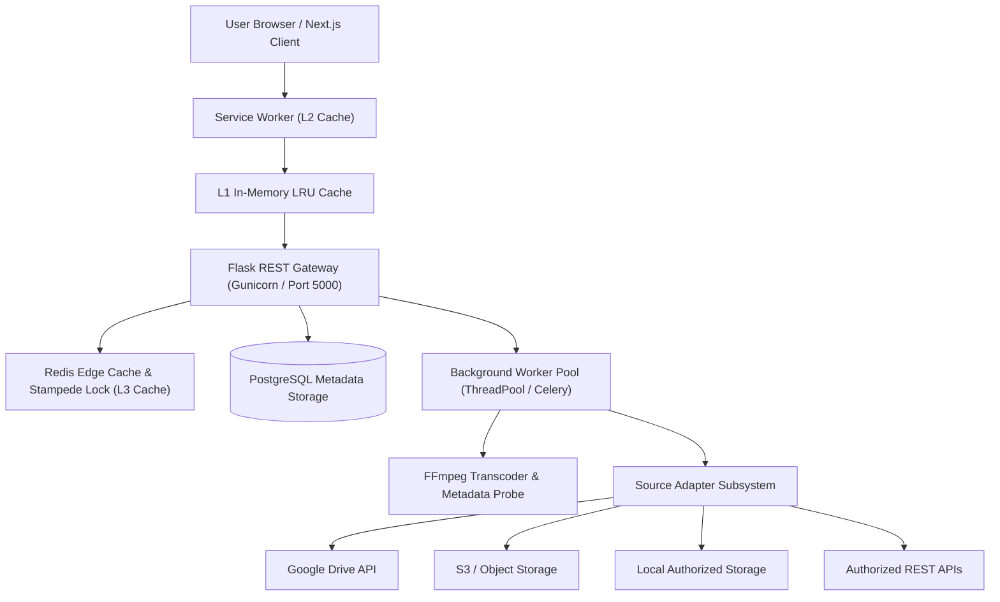

# SmartFlow Architecture Specification

## Overview

SmartFlow is an intelligent, low-latency content delivery, multi-tier caching, and predictive prefetching platform designed for high-concurrency media and dataset distribution. It minimizes perceived latency through bounded prefetching, request coalescing, byte-range media streaming, and offline-resilient local storage.

---

## 1. System Topology

---

## 2. Core Subsystems

### 2.1 Smart Delivery Engine (Client-Side)
The client delivery engine orchestrates:
- **L1 In-Memory LRU Cache**: Sub-2ms instant response for previously loaded metadata and items.
- **Dynamic Lookahead Prefetcher**: Calculates prefetch window size based on real-time NetworkInformation API and RTT.
- **Request Coalescer**: Prevents duplicate parallel fetches for the same content ID.
- **Resilient Offline Store**: Persists session feed and viewed items to browser storage for disconnected consumption.

### 2.2 Flask Application & REST Gateway (Server-Side)
Structured with the Application Factory pattern:
- **Blueprints**: Versioned modular endpoints under `/api/v1/*` (auth, content, feed, search, cache, prefetch, network, analytics, jobs, sources, storage).
- **Service & Repository Pattern**: Clean separation of business logic, database queries, and route handlers.
- **Middleware**: Request ID injection (`X-Request-ID`), structured JSON logging, JWT token verification, and centralized exception handling.

### 2.3 Multi-Tier Caching Pipeline
1. **L1 Browser Memory**: Zero-hop retrieval (&lt; 2ms).
2. **L2 Service Worker**: Intercepts requests, stale-while-revalidate for feeds, cache-first for static assets.
3. **L3 Redis Cluster**: Centralized hot metadata cache, distributed locks to prevent cache stampedes, rate limit counters, and prefetch queue states.

### 2.4 Background Worker & Ingestion Pipeline
- Bounded concurrency worker pool prevents server resource exhaustion.
- Media processing via FFprobe metadata extraction and FFmpeg segmentation.
- Progress updates tracked dynamically (`PENDING`, `QUEUED`, `PROCESSING`, `COMPLETED`, `FAILED`, `CANCELLED`).

### 2.5 Multi-Source Adapter Subsystem
The engine communicates through an abstract interface:
- `get_metadata(source_id)`
- `list_content()`
- `get_content(source_id)`
- `stream_content(source_id, range_header)`
- `get_version(source_id)`
- `check_changes()`

Supported adapters:
- **LocalAuthorizedStorageAdapter**
- **S3Adapter**
- **GoogleDriveAdapter** (Service Account OAuth2)
- **ApiAdapter**
